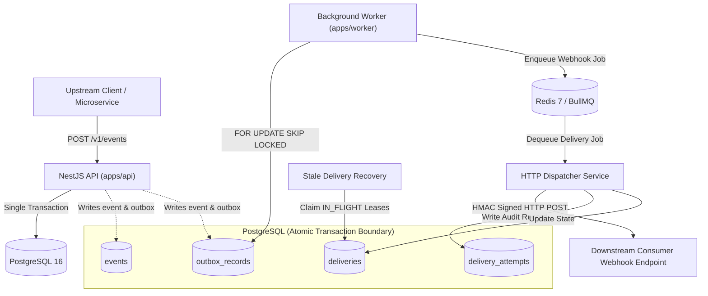
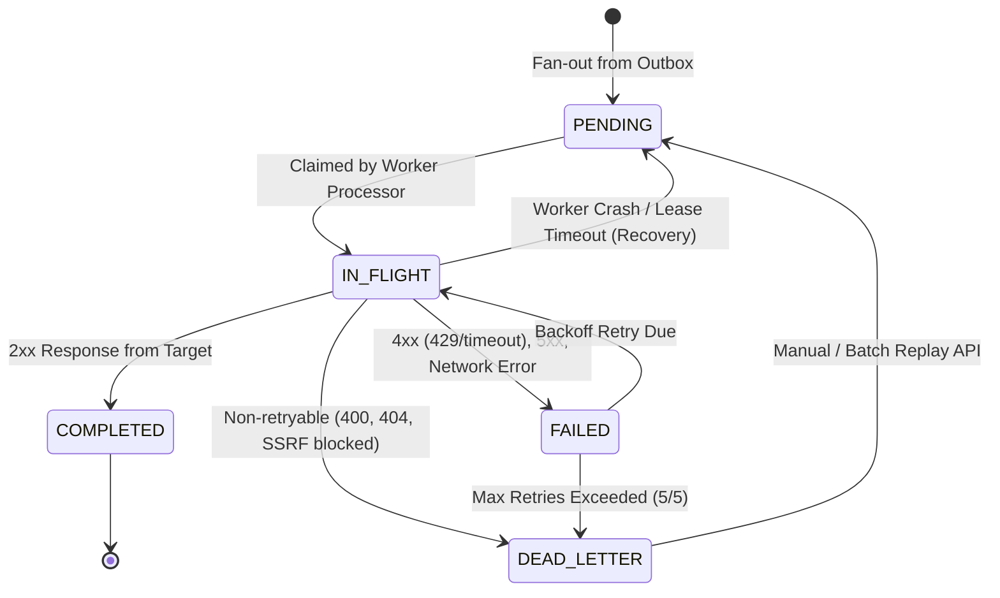

# EventForge — System Architecture & Delivery Semantics

EventForge is a production-grade, multi-tenant webhook delivery and event orchestration platform designed for high availability, zero message loss, and strict at-least-once delivery guarantees.

---

## 1. High-Level System Architecture



---

## 2. The Transactional Outbox Pattern

To prevent dual-write inconsistencies between PostgreSQL and message brokers (e.g., event saved to database, but message queue publish fails), EventForge implements the **Transactional Outbox Pattern**:

1. **Atomic Ingestion**: Incoming events and corresponding `outbox_records` are written within a **single PostgreSQL transaction**.
   - If the transaction commits, both the event and outbox record are guaranteed to exist.
   - If the transaction aborts, neither exists.
2. **Deterministic Conflict Handling**: Concurrent requests with identical `(project_id, idempotency_key)` are resolved atomically using PostgreSQL `ON CONFLICT (project_id, idempotency_key) DO NOTHING`. The concurrent request selects the existing committed event and returns `HTTP 202` without triggering duplicate outbox records or constraint violations.
3. **Safe Outbox Claiming**: The worker polls pending outbox records using:
   ```sql
   SELECT * FROM outbox_records
   WHERE status = 'PENDING'
   ORDER BY created_at ASC
   LIMIT $1
   FOR UPDATE SKIP LOCKED;
   ```
   This prevents race conditions between multiple worker instances without table-level locking.
4. **Fan-Out to Subscriptions**: For each outbox record, the poller matches active subscriptions by event type pattern (`order.*`, `*`, exact match) and inserts initial `deliveries` records in state `PENDING`.
5. **Terminal Outbox State**: If outbox processing encounters persistent unexpected failures, records transition to `DEAD_LETTER` after 10 consecutive attempts, incrementing `eventforge_outbox_dead_letter_total`.

---

## 3. Delivery Lifecycle & State Machine



### State Definitions

| State         | Description                                                                                                                                                        |
| :------------ | :----------------------------------------------------------------------------------------------------------------------------------------------------------------- |
| `PENDING`     | Delivery record created, awaiting BullMQ worker pickup or outbox fanout.                                                                                           |
| `IN_FLIGHT`   | Worker currently holds an active lease (`lease_expires_at = now() + 60s`) and is dispatching the HTTP request.                                                     |
| `COMPLETED`   | Destination server acknowledged the delivery with HTTP `2xx`. Terminal success state.                                                                              |
| `FAILED`      | Transient error occurred (HTTP `5xx`, `429`, connection reset, timeout). Scheduled for exponential backoff retry via BullMQ delayed job.                           |
| `DEAD_LETTER` | Terminal failure state. Reached when attempts reach `max_attempts` (default 5) or on non-retryable errors (e.g. `400 Bad Request`, `404 Not Found`, SSRF blocked). |

---

## 4. Exponential Backoff & Retry Policies

When a delivery encounters a retryable error, EventForge schedules the next attempt using exponential backoff with full jitter to avoid the thundering herd problem:

$$\text{delay} = \min(\text{maxDelayMs}, \text{baseDelayMs} \times 2^{\text{attempt} - 1}) + \text{jitter}$$

- **Base Delay**: 1,000 ms
- **Max Delay**: 300,000 ms (5 minutes)
- **Retryable Errors**: HTTP `500`, `502`, `503`, `504`, `429 Too Many Requests`, socket timeouts, network resets (`ECONNRESET`).
- **Non-Retryable Errors**: HTTP `400 Bad Request`, `401 Unauthorized`, `403 Forbidden`, `404 Not Found`, SSRF validation blocks (`SSRF_BLOCKED`). These transition directly to `DEAD_LETTER` on first failure.

---

## 5. DLQ Replay Semantics

When downstream receiver outages are resolved, operators can replay dead-lettered deliveries via the REST API:

- **Single Replay**: `POST /v1/deliveries/:id/replay`
- **Batch Replay**: `POST /v1/deliveries/replay`

### Atomic Replay Rules

1. **Row-Level Locking**: Replays acquire a `FOR UPDATE` lock on the target delivery.
2. **State Verification**: Only deliveries in `DEAD_LETTER` status can be replayed. Non-DLQ records are rejected with `409 Conflict`.
3. **Attempt History Preservation**: Existing attempt records in `delivery_attempts` are **never deleted**.
4. **Attempt Headroom**: `max_attempts` is atomically incremented by `additional_attempts` (default +3):
   $$\text{max\_attempts}_{\text{new}} = \text{attempts\_count} + \text{additional\_attempts}$$
5. **Dual Scheduling**: The delivery is reset to `PENDING` and enqueued onto BullMQ. If Redis is temporarily unavailable, the background `StaleDeliveryRecoveryService` automatically claims overdue `PENDING` deliveries during database recovery passes.

---

## 6. At-Least-Once Delivery & Consumer Idempotency

EventForge guarantees **at-least-once delivery**: every event matching an active subscription is guaranteed to be delivered at least once, even across worker crashes, network timeouts, and Redis restarts.

Because network failures can occur after a webhook is processed by the receiver but before the HTTP 200 response reaches EventForge, downstream consumers **must implement idempotent handling**.

### Consumer SDK (`@eventforge/sdk`)

The official consumer SDK provides built-in deduplication and HMAC signature verification:

```typescript
import { EventForgeWebhook, MemoryIdempotencyStore } from '@eventforge/sdk';

const idempotencyStore = new MemoryIdempotencyStore({ ttlSeconds: 86400 });
const webhookHandler = new EventForgeWebhook({
  secret: process.env.WEBHOOK_SIGNING_SECRET!,
  toleranceSeconds: 300, // Reject requests older than 5 minutes (replay attack protection)
  idempotencyStore,
});

app.post('/webhook', (req, res) => {
  try {
    const event = webhookHandler.constructEvent({
      payload: req.rawBody,
      signatureHeader: req.headers['x-eventforge-signature'] as string,
    });

    // Check if this event delivery was already processed
    if (idempotencyStore.has(event.id)) {
      return res.status(200).json({ status: 'already_processed' });
    }

    // Process business logic
    handleBusinessEvent(event);
    idempotencyStore.set(event.id);

    res.status(200).json({ received: true });
  } catch (err) {
    res.status(400).json({ error: 'Signature verification failed' });
  }
});
```

---

## 7. W3C Distributed Tracing Propagation

EventForge maintains distributed trace context across the entire lifecycle:

```
[Inbound Request] (traceparent: 00-4bf92f3577b34da6a3ce929d0e0e4736-00f067aa0ba902b7-01)
       │
       ▼
[CorrelationIdMiddleware] (Extracts or generates root W3C trace context)
       │
       ▼
[EventsService] (Stores traceparent into event.metadata JSONB)
       │
       ▼
[OutboxPollerService] (Carries traceparent into BullMQ job payload)
       │
       ▼
[HttpDispatcherService] (Injects child span traceparent into outbound HTTP headers)
       │
       ▼
[Webhook Consumer Request] (traceparent: 00-4bf92f3577b34da6a3ce929d0e0e4736-5c3a2b1f0e4d8a9c-01)
```

This enables complete end-to-end distributed tracing across microservice boundaries in OpenTelemetry-compatible APM tools (Datadog, Jaeger, Grafana Tempo).
