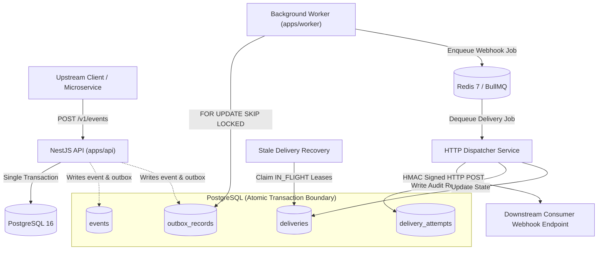
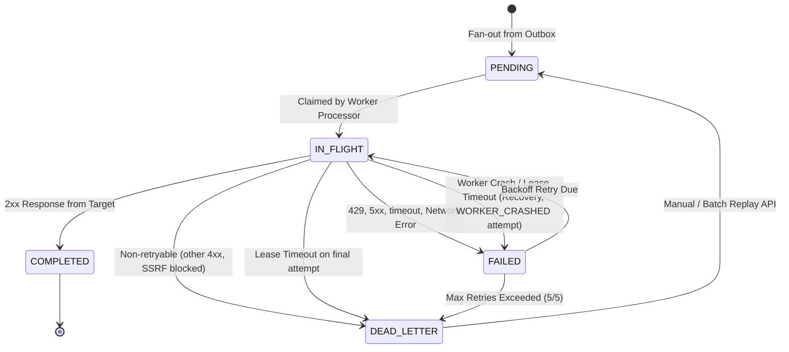

# EventForge — System Architecture & Delivery Semantics

EventForge is a production-grade, multi-tenant webhook delivery and event orchestration platform designed for high availability, zero message loss, and strict at-least-once delivery guarantees.

---

## 1. High-Level System Architecture



---

## 2. The Transactional Outbox Pattern

To prevent dual-write inconsistencies between PostgreSQL and message brokers (e.g., event saved to database, but message queue publish fails), EventForge implements the **Transactional Outbox Pattern**:

1. **Atomic Ingestion**: Incoming events and corresponding `outbox_records` are written within a **single PostgreSQL transaction**.
   - If the transaction commits, both the event and outbox record are guaranteed to exist.
   - If the transaction aborts, neither exists.
2. **Deterministic Conflict Handling**: Concurrent requests with identical `(project_id, idempotency_key)` are resolved atomically using PostgreSQL `ON CONFLICT (project_id, idempotency_key) DO NOTHING`. The concurrent request selects the existing committed event and returns `HTTP 202` without triggering duplicate outbox records or constraint violations.
3. **Safe Outbox Claiming**: The worker polls pending outbox records using:

   ```sql
   WITH candidates AS (
     SELECT id FROM outbox_records
     WHERE status = 'PENDING'
        OR (status = 'PROCESSING' AND claimed_at < NOW() - $timeout)   -- claiming worker died
        OR (status = 'FAILED' AND attempts < $max_attempts
            AND updated_at < NOW() - $timeout)                          -- retry after failure
     ORDER BY created_at ASC
     LIMIT $batch_size
     FOR UPDATE SKIP LOCKED
   )
   UPDATE outbox_records
   SET status = 'PROCESSING', claimed_by = $worker, claimed_at = NOW(),
       attempts = attempts + 1, updated_at = NOW()
   FROM candidates WHERE outbox_records.id = candidates.id
   RETURNING outbox_records.*;
   ```

   Claim and status change happen in one statement, so multiple worker instances never claim the same record, without table-level locking. Records stuck in `PROCESSING` (worker crashed) or `FAILED` (retryable) are reclaimed after a fixed 5 minutes (`claimTimeoutMinutes` in `outbox-poller.service.ts`). The `OUTBOX_LOCK_TIMEOUT_MS` setting exists in the config schema but the poller does not read it.

   **Poll cadence and backlog.** The poller wakes every `OUTBOX_POLL_INTERVAL_MS` (default 1000) and claims up to `OUTBOX_BATCH_SIZE` records (default 50). If a batch comes back full it claims again immediately, up to 20 batches per wake-up, and stops at the first short batch. A failing record cannot be picked up again by that loop, because a `FAILED` record is only claimable after the 5 minutes above. Fan-out inside a batch is serial (about 6-7 ms per record on a local stack, roughly five database and Redis round trips each), so one worker fans out about 150 events per second at most (derived from that per-record time, not measured end to end); ingestion is faster than that, so a sustained burst builds a backlog and delivery latency grows while nothing is lost. Measured locally: a 50-event burst queued behind 300 earlier events took 5.4-5.8 s before the drain loop and 0.8 s after it; with no backlog, an event is delivered in about 1 s (one poll tick plus fan-out).

4. **Fan-Out to Subscriptions**: For each outbox record, the poller matches active subscriptions by event type pattern (`order.*`, `*`, exact match) and inserts initial `deliveries` records in state `PENDING`.
5. **Terminal Outbox State**: If outbox processing encounters persistent unexpected failures, records transition to `DEAD_LETTER` after 10 consecutive attempts, incrementing `eventforge_outbox_dead_letter_total`.

---

## 3. Delivery Lifecycle & State Machine



### State Definitions

| State         | Description                                                                                                                                                                                                                                                                                                                |
| :------------ | :------------------------------------------------------------------------------------------------------------------------------------------------------------------------------------------------------------------------------------------------------------------------------------------------------------------------- |
| `PENDING`     | Delivery record created, awaiting BullMQ worker pickup or outbox fanout.                                                                                                                                                                                                                                                   |
| `IN_FLIGHT`   | A worker has claimed the delivery and is dispatching the HTTP request. The lease is derived from `deliveries.updated_at`: if it is older than `DELIVERY_LEASE_TIMEOUT_MS` (default 60s, always at least `WEBHOOK_TIMEOUT_MS` + 30s) the delivery is treated as abandoned and recovered. There is no separate lease column. |
| `COMPLETED`   | Destination server acknowledged the delivery with HTTP `2xx`. Terminal success state.                                                                                                                                                                                                                                      |
| `FAILED`      | Transient error occurred (HTTP `5xx`, `429`, connection reset, timeout). Scheduled for exponential backoff retry via BullMQ delayed job.                                                                                                                                                                                   |
| `DEAD_LETTER` | Terminal failure state. Reached when attempts reach `max_attempts` (default 5) or on non-retryable errors (e.g. `400 Bad Request`, `404 Not Found`, SSRF blocked).                                                                                                                                                         |

---

## 4. Exponential Backoff & Retry Policies

When a delivery encounters a retryable error, EventForge schedules the next attempt using exponential backoff with **full jitter** to avoid the thundering herd problem:

$$\text{delay} = \text{random}\left[0,\ \min(\text{maxDelayMs},\ \text{baseDelayMs} \times 2^{\text{attempt} - 1})\right)$$

- **Base Delay**: 1,000 ms
- **Max Delay**: 86,400,000 ms (24 hours)
- **`Retry-After`**: if the receiver sends one (seconds or HTTP date), it is used instead of the computed delay, clamped to between 1 second and 24 hours.
- **Retryable**: HTTP `429`, any HTTP `5xx`, and transport errors `TIMEOUT`, `ETIMEDOUT`, `ECONNREFUSED`, `ECONNRESET`, `ENOTFOUND`, `NETWORK_ERROR`.
- **Non-Retryable** (straight to `DEAD_LETTER` on first failure): every other `4xx` (e.g. `400`, `401`, `403`, `404`), `SSRF_BLOCKED`, `INVALID_URL`, `UNSUPPORTED_PROTOCOL`, and any unclassified error.
- **Exhaustion**: once `attempts_count` reaches `max_attempts` (default 5) the delivery moves to `DEAD_LETTER` regardless of error type.

---

## 5. DLQ Replay Semantics

When downstream receiver outages are resolved, operators can replay dead-lettered deliveries via the REST API:

- **Single Replay**: `POST /v1/deliveries/:id/replay`
- **Batch Replay**: `POST /v1/deliveries/replay`

### Atomic Replay Rules

1. **Row-Level Locking**: Replays acquire a `FOR UPDATE` lock on the target delivery.
2. **State Verification**: Only deliveries in `DEAD_LETTER` status can be replayed. Non-DLQ records are rejected with `409 Conflict`.
3. **Attempt History Preservation**: Existing attempt records in `delivery_attempts` are **never deleted**.
4. **Attempt Headroom**: `max_attempts` is reset to `attempts_count + additional_attempts` (default +3, clamped to 1–10):
   $$\text{max\_attempts}_{\text{new}} = \text{attempts\_count} + \text{additional\_attempts}$$
5. **Dual Scheduling**: The delivery is reset to `PENDING` and enqueued onto BullMQ. If Redis is temporarily unavailable, the background `StaleDeliveryRecoveryService` automatically claims overdue `PENDING` deliveries during database recovery passes.

---

## 6. At-Least-Once Delivery & Consumer Idempotency

EventForge guarantees **at-least-once delivery**: every event matching an active subscription is guaranteed to be delivered at least once, even across worker crashes, network timeouts, and Redis restarts.

Because network failures can occur after a webhook is processed by the receiver but before the HTTP 200 response reaches EventForge, downstream consumers **must implement idempotent handling**.

### Consumer SDK (`@eventforge/sdk`)

The official consumer SDK provides built-in deduplication and HMAC signature verification:

```typescript
import { EventForgeWebhook, MemoryIdempotencyStore } from '@eventforge/sdk';

const idempotencyStore = new MemoryIdempotencyStore({ ttlSeconds: 86400 });
const webhookHandler = new EventForgeWebhook({
  secret: process.env.WEBHOOK_SIGNING_SECRET!,
  toleranceSeconds: 300, // Reject requests older than 5 minutes (replay attack protection)
  idempotencyStore,
});

app.post('/webhook', (req, res) => {
  try {
    const event = webhookHandler.constructEvent({
      payload: req.rawBody,
      signatureHeader: req.headers['x-eventforge-signature'] as string,
    });

    // Check if this event delivery was already processed
    if (idempotencyStore.has(event.id)) {
      return res.status(200).json({ status: 'already_processed' });
    }

    // Process business logic
    handleBusinessEvent(event);
    idempotencyStore.set(event.id);

    res.status(200).json({ received: true });
  } catch (err) {
    res.status(400).json({ error: 'Signature verification failed' });
  }
});
```

---

## 7. W3C Distributed Tracing Propagation

EventForge maintains distributed trace context across the entire lifecycle:

```
[Inbound Request] (traceparent: 00-4bf92f3577b34da6a3ce929d0e0e4736-00f067aa0ba902b7-01)
       │
       ▼
[CorrelationIdMiddleware] (Extracts or generates root W3C trace context)
       │
       ▼
[EventsService] (Stores traceparent into event.metadata JSONB)
       │
       ▼
[OutboxPollerService] (Carries traceparent into BullMQ job payload)
       │
       ▼
[HttpDispatcherService] (Injects child span traceparent into outbound HTTP headers)
       │
       ▼
[Webhook Consumer Request] (traceparent: 00-4bf92f3577b34da6a3ce929d0e0e4736-5c3a2b1f0e4d8a9c-01)
```

This enables complete end-to-end distributed tracing across microservice boundaries in OpenTelemetry-compatible APM tools (Datadog, Jaeger, Grafana Tempo).

---

## 8. API Protection

- **Rate limiting** (`RateLimitGuard`): fixed-window counters in Redis (`INCR` + `PEXPIRE`), so limits are shared across API replicas. Two buckets are checked on every request, _before_ authentication: per client IP (`RATE_LIMIT_IP_MAX`, which also throttles guessing of invalid API keys) and, when a key is presented, per API key (`RATE_LIMIT_KEY_MAX`, keyed by the SHA-256 of the key so raw keys never reach Redis). Defaults: 1,200 / 2,400 requests per 60 s window. Exceeding either returns `429` with a `Retry-After` header. If Redis is unavailable the limiter fails open and logs a warning.
- **Client IP behind a proxy**: set `TRUST_PROXY_HOPS` to the number of reverse proxies in front of the API; otherwise every request appears to come from the proxy.
- **Security headers**: `helmet` defaults on every response (a relaxed CSP is applied only to the `/docs` Swagger UI); `X-Powered-By` is disabled.
- **CORS**: explicit allow-list via `CORS_ALLOWED_ORIGINS` (comma-separated). Default is empty: browsers on other origins receive no CORS headers. Non-browser clients (no `Origin` header) are unaffected.
- **`/metrics`**: when `METRICS_TOKEN` is set it requires `Authorization: Bearer <token>`. When unset it is open outside production and returns `404` in production. The worker's metrics server is not published by the production compose file.

## 9. Per-Subscription Rate Limiting (`rateLimitPerSecond`)

A subscription may set `rateLimitPerSecond` to cap deliveries to its endpoint. Throttling is performed in the worker before a delivery is claimed:

1. The worker looks up the subscription's limit and atomically reserves the next free time slot in Redis (a GCRA-style scheduler in a Lua script, using Redis `TIME` so all workers share one clock). Up to `rateLimitPerSecond` deliveries may run immediately (burst); beyond that, slots are spaced `1000 / rateLimitPerSecond` ms apart.
2. If the slot is in the future, the job is re-enqueued in BullMQ with that delay and a `throttleReserved` flag, and the delivery row is left untouched. Throttling therefore **never consumes a retry attempt** and never changes delivery state. The flag stops the job paying for a second slot when it runs.
3. Each retry attempt reserves a fresh slot. Excess deliveries are delayed, not dropped. Throttled jobs are counted in `eventforge_deliveries_throttled_total`.
4. If Redis is unavailable the throttle fails open.

Limitation: a large backlog for a slow subscription is held as delayed BullMQ jobs, one per delivery, until their slots arrive.

## 10. Data Retention

The worker runs a retention job every `RETENTION_INTERVAL_MS` (default hourly). `RETENTION_DAYS` (default 30; `0` disables) sets the window.

- Deletes `COMPLETED` deliveries whose `completed_at` is older than the window; their `delivery_attempts` cascade.
- Deletes events older than the window **only if** no deliveries remain for them and their outbox record is `PROCESSED` (or absent); outbox rows cascade with the event.
- **Never deletes** `PENDING`, `IN_FLIGHT`, `FAILED` or `DEAD_LETTER` deliveries, their attempt history, or events not yet fanned out, however old, so unfinished work and replayable dead letters are preserved.
- Deletes run in batches of `RETENTION_BATCH_SIZE` using `FOR UPDATE SKIP LOCKED`, so replicas and live processing do not block each other. Deleted counts are exported as `eventforge_retention_deleted_total{table}`.

## 11. Tenant Administration

Projects and API keys are managed with the admin CLI (`pnpm admin <command>` in development, `pnpm admin:prod` or `node packages/database/dist/scripts/admin.js` in the production image): `project:create`, `project:list`, `key:create`, `key:list`, `key:revoke`, `key:rotate`. Raw keys are printed once; only SHA-256 hashes are stored. A revoked key receives `401` immediately; `key:rotate` revokes the old key and issues a new one atomically.
